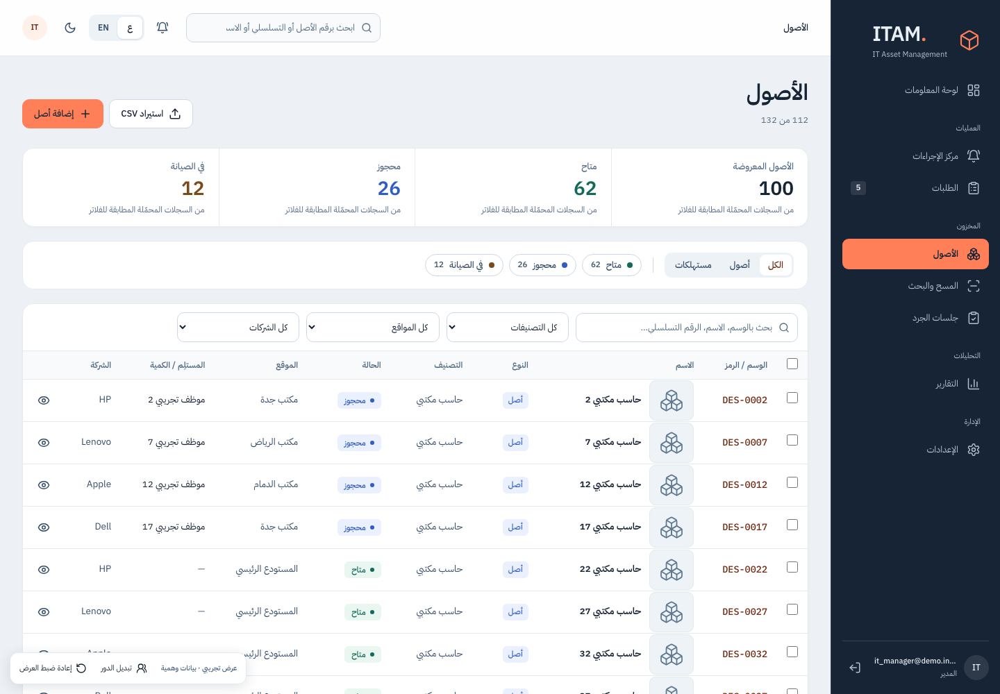

# ITAM | IT Asset & Inventory Management

ITAM connects asset records, custody, inventory, requests, approvals, maintenance and stocktaking, with separate staff and customer experiences.

**My role:** I am Mubark, the developer responsible for building and delivering the project. My work covers the application interface, operational workflows, database integration and access boundaries, plus the independent React demo used to explain those workflows.

**Core stack:** TypeScript · React · Next.js · Supabase · PostgreSQL / RLS

**Independent demo:** React · Vite · local synthetic transport/state

**Testing:** Vitest · Playwright · pgTAP



## What I built

- Asset lifecycle records, employee custody, assignments, returns, transfers and activity history.
- Request and approval workflows through warehouse fulfillment, including stock receipt, issue and low-stock tracking.
- Maintenance, stocktakes, QR labels/scanning, dashboards and CSV workflows.
- Employee self-service and a separate customer portal, with customer/requester ownership boundaries.
- Arabic/English interfaces with right-to-left layouts.
- Database-level financial restrictions, privileged RPCs and a public QR projection limited to five fields.

This is a sanitized portfolio edition. It contains source and an independent synthetic demo, without real customer/staff records, original environments, financial exports, operational reports or original Git history.

## Try the independent demo

Use Node.js 24. From the repository root:

```sh
cd standalone-demo
npm ci --ignore-scripts --no-audit --no-fund
cd ..
node tools/run-offline.mjs demo
```

Open **http://127.0.0.1:4173**. Choose a persona to explore the manager, employee, warehouse, read-only or customer experience. No account or Supabase credentials are required.

The demo fulfills SDK requests through a local transport with no native-fetch fallback. Data is synthetic and persisted only in the browser's local storage/IndexedDB; use **Reset demo** to start again. It sends no real messages, calls no paid AI and contacts no production backend. Persona selection simulates interface roles; it does not establish production authorization. Seeded employee/contact names are explicitly synthetic, phone placeholders are non-dialable, and contact emails use `.invalid`.

## Two separate applications

| Path | Purpose |
|---|---|
| `nextjs-app` | Next.js application source, SQL reference, operational contracts and tests |
| `standalone-demo` | Independent React/Vite browser demo with synthetic adapters |
| `tools` | Reviewed commands, environment allowlist and network guard |

The standalone demo is not the Next.js server or a database clone. The core source is provided for code review; hosted account bindings are disabled. The local runner rejects production settings rather than inheriting original secrets.

Equipment artwork is newly authored placeholder imagery. Third-party font notices remain included.

## Verification and limits

Clean installation succeeded for both applications with lifecycle scripts disabled and unchanged lockfiles. Missing core archives came only from the official npm registry and matched lockfile integrity. Core lint/typecheck/build and **1612 tests in 166 files** passed in the clean tree. The final independent demo passed typecheck, build and **89 tests**, including privacy invariants. It has no separate lint command, so its TypeScript result is not reported as lint.

Covered Chromium flows passed: persona selection, manager inventory, customer portal, staff-route denial for portal personas, synthetic request creation and reload persistence, read-only asset-create visibility, reset-dialog focus/Escape and unknown-route recovery. Three targeted axe checks had zero violations; other routes and earlier static-source findings are not cleared by those checks.

A disposable local PostgreSQL replay passed **119 of 121 local manifest steps**; two outbound scheduler migrations were excluded. A rollback-only pgTAP probe passed **27 assertions** covering customer/requester isolation, financial grants/RPCs, closed registration, disabled portal access and the exact public QR fields (`asset_tag`, `name`, `status`, `category`, `location`). No application authorization policy or trigger was weakened for the test.

Local Auth/Storage SQL fixtures are not a full Supabase HTTP stack. Full integration, external workers/schedulers, recovery rehearsal, all workflows and dependency vulnerability clearance remain unverified. Historical hosted release/E2E contracts were adapted to explicitly local, non-deploying review behavior; no old production permission was restored. See [the contract mapping](nextjs-app/docs/PUBLICATION_CONTRACTS.md).

See [runtime evidence and six screenshots](RUNTIME_VERIFICATION.md), [source provenance](SOURCE.md), and [the Arabic summary](SUMMARY_AR.md). No live deployment or production connection is included.

## Rights and safe use

No open-source application license is granted by this publication. Existing third-party licenses and notices remain applicable. Source visibility does not grant rights to third-party assets.

Do not add original environments, private records, photos, financial exports or deployment bindings. Private source audits and recovery bundles belong outside this repository. Deleting files or adding ignore rules does not remove secrets from an older history; this edition uses a new, separately reviewed history. No complete-security claim is made.
